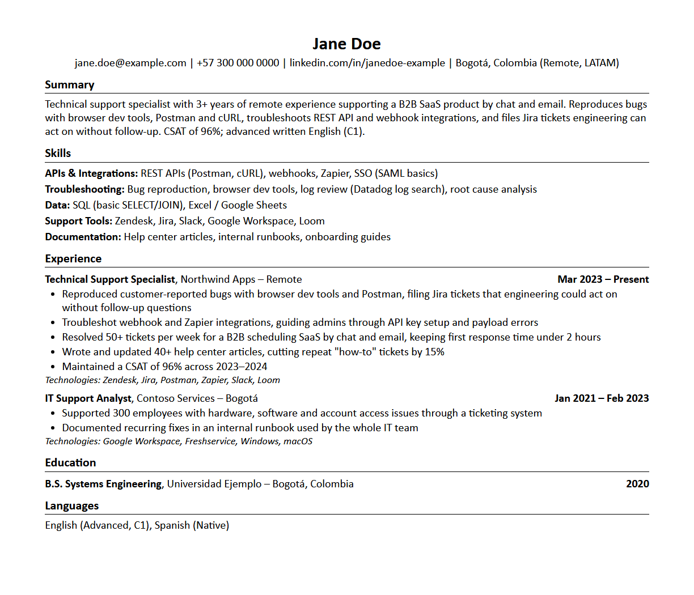

# Mi Primera Chamba

[English](README.md) · **Español**

Un asistente de búsqueda de empleo que corre dentro de [Claude Code](https://claude.com/claude-code). Encuentra vacantes abiertas que encajan con tu CV y prepara para cada una un CV adaptado y compatible con ATS. **Tú** decides a cuáles postularte y **tú** envías cada solicitud.


<sub>CV adaptado de una candidata ficticia, generado a partir de [`example/`](example/).</sub>

## Por qué existe

Las herramientas de "auto-apply" envían cientos de solicitudes genéricas o infladas con IA a tu nombre. Los reclutadores las marcan como spam y casi no consiguen entrevistas. Este proyecto hace lo contrario:

| Bots de auto-apply | Mi Primera Chamba |
|---|---|
| Aplican por ti, en masa | Prepara; **tú** aplicas |
| Reescriben tu experiencia libremente | **Cada afirmación tiene respaldo** en tu CV real o en una habilidad que confirmaste |
| Cientos de solicitudes sin enfoque | 5–10 vacantes verificadas y ordenadas por búsqueda |
| Tus datos en sus servidores | Tus datos se quedan en una carpeta local que Git ignora |

## Qué hace

1. **Aprende tu perfil.** Lee tu CV y te hace unas preguntas: puestos que buscas, países donde puedes trabajar, salario mínimo y lo que descartas.
2. **Busca vacantes temprano.** Un script lee en segundos, y sin gastar IA, las APIs públicas de empleo de tus empresas objetivo (Greenhouse, Lever, Ashby, Workable, SmartRecruiters, Breezy, Recruitee, Teamtailor, Rippling). Puede correr cada mañana en GitHub Actions y avisarte de vacantes nuevas por correo y en el celular, para que apliques en los primeros días, con la computadora apagada. Claude descubre empresas nuevas con *dorks* de búsqueda que apuntan a esos sistemas en lugar de a los portales saturados. Comprueba que cada vacante siga abierta y que seas elegible, y las ordena por *afinidad* (1–5).
3. **Adapta tu CV.** Para la vacante que elijas, primero escribe una ficha corta de la empresa y revisa si encajas. Después relaciona cada requisito con tu experiencia y te pregunta por las habilidades que faltan, en vez de inventarlas. Genera un PDF de una página, con texto real y a una columna, y lo revisa contra problemas de ATS y de lectura rápida.
4. **Te ayuda a llegar a quien contrata.** En empresas chicas encuentra a la persona responsable del puesto y redacta un mensaje corto y personal para que tú lo envíes.
5. **Lleva el registro sin pedirte nada.** Anota cada vacante vista para no repetírtela. Detecta las vacantes cerradas en el ATS del empleador y el resultado de tus postulaciones a partir de tus correos de confirmación y rechazo, así no tienes que avisar nada.

## Requisitos

- [Claude Code](https://claude.com/claude-code), que requiere suscripción Claude Pro/Max o una API key
- [Node.js](https://nodejs.org) 18 o superior
- Google Chrome, Microsoft Edge, Chromium o Brave, que se usa en modo headless para imprimir el PDF
- Windows, macOS o Linux

## Inicio rápido

```bash
git clone https://github.com/farevoir/buscador-chamba.git
cd buscador-chamba
claude
```

Luego háblale normal, en cualquier idioma:

| Tú dices | Qué pasa |
|---|---|
| *"Configura mi perfil, aquí está mi CV: C:\Users\yo\Descargas\cv.pdf"* | `setup-profile` crea tu carpeta privada `my-data/` |
| *"Busca vacantes"* | `find-jobs` te da una lista de vacantes verificadas, ordenadas por afinidad |
| *"Hazme un CV para esta vacante: <enlace o texto>"* | `tailor-cv` genera un PDF adaptado, la ficha de la empresa y notas para la entrevista |
| *"¿A quién le escribo en Acme?"* | `outreach` encuentra a quien contrata y redacta un mensaje para que tú lo envíes |
| *"Ya apliqué a Acme"* / *"¿Cómo va mi búsqueda?"* | `track-applications` actualiza estados y te dice a qué darle seguimiento |

### Alerta diaria en la nube (sin computadora)

Guarda `my-data/` en un repo **privado** de GitHub y deja que GitHub Actions corra el escaneo cada mañana, gratis (cerca de 1 minuto de Actions al día). Las vacantes nuevas llegan como un *issue* de GitHub, que te avisa por correo y en la app de GitHub del celular.

1. Convierte `my-data/` en su propio repo privado: `git -C my-data init`, haz commit y luego `gh repo create <tú>/<nombre>-data --private --source my-data --push`.
2. Copia [`templates/github-actions/daily-scan.yml`](templates/github-actions/daily-scan.yml) a `my-data/.github/workflows/` y haz push. Define la variable de repositorio `TOOL_REPO` si usas un fork de este repo.
3. En tu computadora, los hooks de Claude Code del proyecto bajan `my-data/` al iniciar sesión y lo suben cuando Claude termina cada respuesta (`scripts/sync-data.mjs`), así ambos lados quedan sincronizados.

¿Prefieres que todo quede local? Programa `node scripts/jobs.mjs daily` con el Programador de tareas o cron y revisa `my-data/new-postings.md`.

Con tus datos en GitHub, también puedes abrir el repo de datos en Claude Code en la web desde el celular.

¿Quieres ver el resultado antes? Revisa [`example/`](example/). Ahí están el perfil, el registro y el CV adaptado de una candidata ficticia.

## Úsalo desde el celular

Inicia Claude Code en tu computadora y activa **Remote Control**. Desde ese momento lo puedes manejar con la app de Claude o desde claude.ai. El trabajo lo hace tu computadora, así que tiene que quedarse encendida y sin suspenderse. Claude te puede mandar los PDF al celular para que apliques desde ahí.

## Estructura

```
my-data/                    TUS datos (ignorados por Git). Misma forma que example/
├── applications.md         Cada vacante vista y su estado: empieza aquí
├── new-postings.md         Lo que encontró la alerta diaria
├── jobs/<empresa>-<puesto>/  Por vacante: cv.html + PDF adaptado, job.md (ficha, huecos, notas de entrevista), outreach.md
├── profile/                Sobre ti: cv-base.md, cv.html, confirmed-skills.md, search-profile.md, targets.json
└── .state/                 Estado interno de los scripts; no hace falta abrirlo

example/                    Candidata ficticia (Jane Doe) con todos los resultados, más cv-preview.png
templates/                  Versiones vacías de los archivos de perfil, para setup-profile
.claude/skills/             Las skills: setup-profile, find-jobs, tailor-cv, outreach, track-applications
scripts/
├── jobs.mjs                scan · daily · tidy · posting (APIs públicas de ATS, sin IA)
├── html-to-pdf.mjs         HTML → PDF con un navegador Chromium local, más revisión del CV
├── sync-data.mjs           Baja y sube my-data/ cuando es un repo git privado (hooks de Claude Code)
└── lib/                    Código compartido: adaptadores de ATS, lector del registro, rutas, texto
```

También puedes generar cualquier CV a mano:

```bash
node scripts/html-to-pdf.mjs my-data/profile/cv.html
```

## Privacidad

- Todo lo personal vive en `my-data/`, que está en `.gitignore`. Hacer push de tu fork nunca publica tu CV.
- Mientras lo usas, Claude Code envía tu CV y las vacantes a la API de Anthropic para procesarlos. Las búsquedas y las consultas de páginas van a los sitios de empleo. No se sube nada más.
- Nunca se envía nada a un empleador. Tú mandas cada solicitud y cada mensaje.
- Las búsquedas cubren solo empresas y vacantes. Nunca busca correos ni teléfonos privados de personas.
- Si conectas Gmail u Outlook a Claude, `track-applications` lee solo los correos de postulación (confirmaciones, rechazos, invitaciones a entrevista) para actualizar tu registro, así nunca tienes que avisar que aplicaste. Nunca responde, mueve ni borra correos.

## Límites

- LinkedIn e Indeed bloquean la lectura automática. Si pegas el texto de la vacante, el CV se adapta igual.
- Las bolsas de empleo tienen muchas vacantes viejas. Calcula que sobreviven a la verificación unos 2 de cada 7 resultados.
- Muchas vacantes no publican el salario. Esas quedan **por verificar** en lugar de descartarse.
- La plantilla del CV es sencilla a propósito. Los ATS leen mejor los diseños de una columna con texto real.

## Personalizar

- **Criterios:** edita `my-data/profile/search-profile.md` o di *"cambia mis criterios de búsqueda"*.
- **Empresas a vigilar:** agrega tableros a `my-data/profile/targets.json` (p. ej. `{ "ats": "greenhouse", "board": "gitlab" }`) y corre `node scripts/jobs.mjs scan`.
- **Diseño del CV:** edita `templates/cv-template.html` antes de configurar tu perfil, o `my-data/profile/cv.html` después. Mantenlo a una columna.
- **Mejores fuentes para tu país:** `find-jobs` anota lo que funcionó en la sección "Source notes" de tu perfil.

## Licencia

[MIT](LICENSE). Úsalo para tu propia búsqueda, haz fork y adáptalo. Solo te pido que respetes la idea de que una persona decide: no lo conviertas en un bot de auto-apply.
