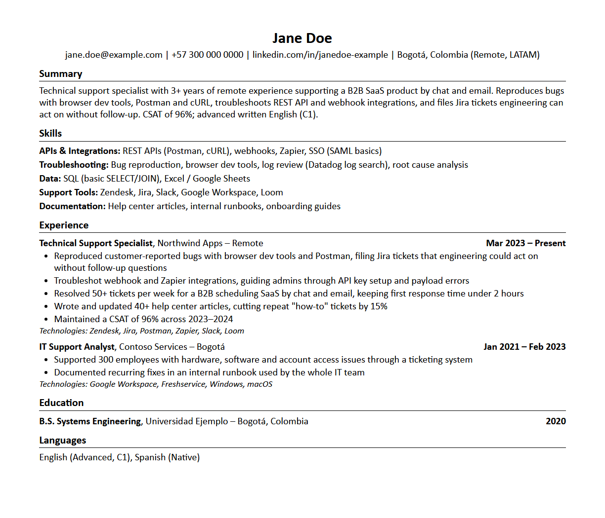

# Buscador de Chamba

**English** · [Español](README.es.md)

A job search assistant that runs inside [Claude Code](https://claude.com/claude-code). It finds open positions that fit your CV and writes an ATS-friendly CV tailored to each one. **You** decide what to apply to, and **you** submit every application.

> *"Buscar chamba"* is Mexican slang for "looking for a job".


<sub>A tailored CV for a fictional candidate, generated from [`example/`](example/).</sub>

## Why it exists

"Auto-apply" tools send hundreds of generic or AI-inflated applications in your name. Recruiters flag them as spam and interview rates stay low. This project takes the opposite approach:

| Auto-apply bots | Buscador de Chamba |
|---|---|
| Apply for you, in bulk | Prepares; **you** apply |
| Rewrite your experience freely | **Every claim is backed** by your real CV or a skill you confirmed |
| Hundreds of untargeted applications | 5–10 verified, ranked postings per search |
| Your data on their servers | Your data stays in a local folder that Git ignores |

## What it does

1. **Learns your profile.** It reads your CV and asks a few questions: target roles, countries you can work for, minimum salary, dealbreakers.
2. **Finds jobs.** It searches remote-job boards and company career pages, checks that each posting is still open and that you're eligible, then ranks the postings by *affinity* (1–5).
3. **Tailors your CV.** For a posting you like, it maps each requirement to your experience. It asks you about missing skills instead of inventing them, then renders a one-page PDF with real text and a single column, so ATS can read it.
4. **Tracks everything.** It keeps a log of every posting seen, so you never get the same posting twice. It also tells you which applications are due for a follow-up.

## Requirements

- [Claude Code](https://claude.com/claude-code) (needs a Claude Pro/Max subscription or an API key)
- [Node.js](https://nodejs.org) 18 or newer
- Google Chrome, Microsoft Edge, Chromium or Brave (used headless to print the PDF)
- Windows, macOS or Linux

## Quick start

```bash
git clone https://github.com/farevoir/buscador-chamba.git
cd buscador-chamba
claude
```

Then just talk to it in plain language, in any language:

| You say | What happens |
|---|---|
| *"Set up my profile, here's my CV: ~/Downloads/cv.pdf"* | `setup-profile`: creates your private `my-data/` folder |
| *"Find me jobs"* | `find-jobs`: returns a ranked list of verified postings |
| *"Make a CV for this posting: <link or pasted text>"* | `tailor-cv`: creates a tailored PDF plus interview notes |
| *"I applied to Acme"* / *"How is my search going?"* | `track-applications`: updates statuses and lists follow-ups |

Want to see the output first? Browse [`example/`](example/): a fictional candidate's profile, application log and tailored CV.

## Use it from your phone

Start Claude Code on your computer and turn on **Remote Control**, and you can drive it from the Claude mobile app or claude.ai. Your computer does the work, so it has to stay on and awake. Claude can send you the generated PDFs on your phone, so you can apply right there.

## Project layout

```
.claude/skills/         The four skills (setup-profile, find-jobs, tailor-cv, track-applications)
scripts/html-to-pdf.mjs HTML → PDF with a local Chromium browser, no dependencies
templates/              Blank profile files and the CV template
example/                A fictional candidate showing every output
GLOSSARY.md             Shared vocabulary (affinity, gap, to verify…)
my-data/                YOUR data: CV, profile, applications, tailored CVs (git-ignored)
```

You can also render any CV by hand:

```bash
node scripts/html-to-pdf.mjs my-data/cv.html
```

## Privacy

- Everything personal lives in `my-data/`. That folder is in `.gitignore`, so pushing your fork never publishes your CV.
- While you use it, Claude Code sends your CV and the job postings to Anthropic's API to process them. Web searches and page fetches go to the job sites. Nothing else is uploaded.
- Nothing is ever sent to an employer. You submit each application yourself.

## Limits

- LinkedIn and Indeed block automated reading. Paste those postings as text and the CV still gets tailored.
- Job boards are full of stale postings. Expect roughly 2 out of 7 search results to survive verification.
- Salaries are often unpublished. Those postings are marked **to verify** instead of being discarded.
- The CV template is deliberately plain. Single-column, real-text layouts parse best in applicant tracking systems.

## Customize

- **Criteria:** edit `my-data/search-profile.md` or say *"change my search criteria"*.
- **CV design:** edit `templates/cv-template.html` before setup, or `my-data/cv.html` after it. Keep it single-column.
- **Better sources for your country:** `find-jobs` appends what worked to the "Source notes" section of your profile.

## License

[MIT](LICENSE). Use it for your own job search, fork it and adapt it. Please keep the human-in-the-loop spirit: don't turn it into an auto-apply bot.
